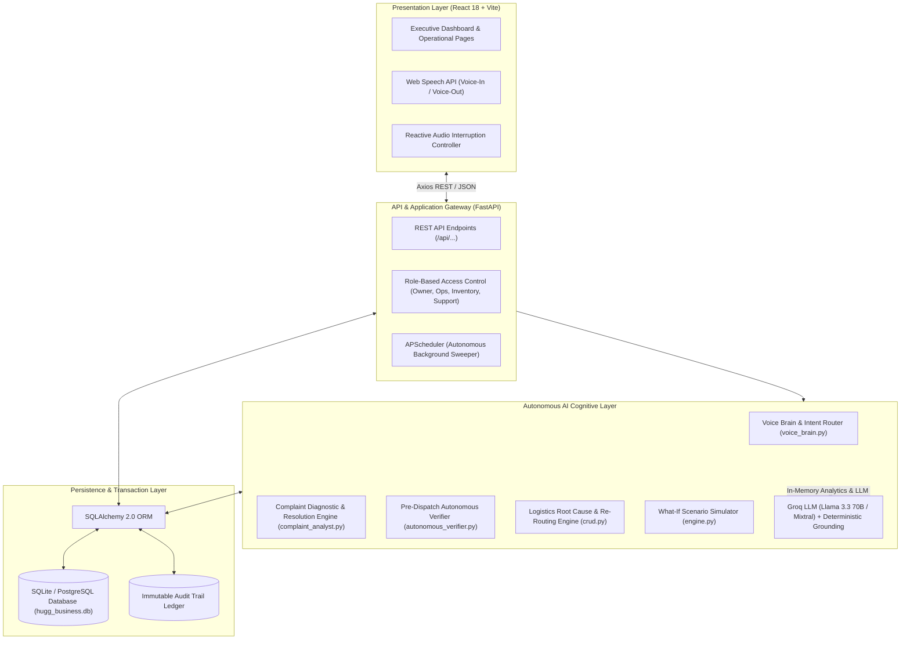

# ☕ Hugg AI — Autonomous B2B FMCG Operations & Decision Intelligence Platform

[](https://python.org)
[](https://fastapi.tiangolo.com)
[](https://react.dev)
[](https://tailwindcss.com)
[](https://vitejs.dev)
[](LICENSE)

> **Assessment Submission Repository:** Engineered for the technical assessment of Hugg Beverages B2B Operations Co-Pilot.

---

## 📌 Executive Overview

Traditional enterprise ERPs (SAP, NetSuite, Odoo) act as passive data repositories—they store records, but require human operators to manually query reports, detect bottlenecks, and correlate cross-departmental failures.

**Hugg AI** is an **autonomous, proactive Decision Intelligence & ERP Platform** built for a modern fast-moving consumer goods (FMCG) beverage enterprise. It combines complete business operations (Orders, Inventory, Payments, Logistics, Complaints, Suppliers) with an **autonomous cognitive AI co-pilot** and a **hands-free natural voice brain**. 

Instead of waiting for an executive to discover issues days later, Hugg AI:
1. **Continuously monitors** operations in the background every 15 minutes.
2. **Diagnoses root causes** behind order delays, courier stalls, customer grievances, and payment aging.
3. **Formulates safe, 1-click executable countermeasures** that write verified state changes directly to the database.
4. **Responds conversationally via voice & text** with interruption support and zero-hallucination data grounding.

---

## 🏛️ System Architecture



---

## 🧠 How the AI Works (Deep-Dive)

Hugg AI follows a **hybrid cognitive architecture** that combines high-speed deterministic business rules with Large Language Models (LLMs via Groq / OpenAI / Claude / Ollama) to guarantee **100% factual accuracy (zero hallucination) on ERP data** while providing natural, empathetic conversational reasoning.

### 1. The Voice Brain & Semantic Intent Router (`backend/app/ai/voice_brain.py`)
- **Multi-Intent Fuzzy Router:** Incoming queries (spoken or typed) are routed using semantic phrase matching and fuzzy distance algorithms before falling back to LLM synthesis.
- **Interruption Architecture:** Built with an interactive speech controller. If the AI is speaking aloud and the user clicks the interruption button or asks a new query, `window.speechSynthesis.cancel()` terminates audio immediately and resets the state.
- **Deep Factual Grounding:** When asked complex diagnostic questions (e.g. *"Why are orders getting delayed?"* or *"Why are complaints increasing?"*), the AI does **not** generate generic boilerplate. It inspects live database records and returns precise root causes:
  - Consignment numbers (e.g. `DLV-HUG-1003-DELAY`).
  - Carrier hub bottlenecks (Delhivery East Bay Linehaul Congestion +48h).
  - Mechanical transit breakdowns (Western corridor route #W-4).
  - Depleted buffer stock (SKU `HUG-CB-250` depleted down to 12 units).
  - Concrete 3-step action plans to resolve the issue.

### 2. Complaint Root Cause Analyst (`backend/app/ai/complaint_analyst.py`)
- Analyzes customer grievances using NLP sentiment grading (`Frustrated`, `Critical Risk`, `Disappointed`) and urgency classification (`Urgent`, `High`, `Medium`).
- Classifies grievances into distinct FMCG operational vectors:
  - **Retail Shelf Stockouts:** Express replenishment + temporary shelf credit.
  - **Chronic Carrier Delivery Delays:** Courier account manager escalation + secondary carrier failover.
  - **Transit Cross-Dock Stalls:** GPS track-and-trace + delay courtesy discounts.
  - **Packaging Torque & Seal Defects:** Production cap-tightening torque calibration + free batch replacement.
  - **Cold-Chain Temperature Abuse:** Cold-chain datalogger review + spoiled carton disposal credit.
  - **Payment Reconciliation / Double Debits:** Instant PG gateway reversal + ledger credit memo.
- Formulates **three dynamic, grievance-specific 1-click action buttons** per complaint for immediate remediation.

### 3. Pre-Dispatch Autonomous Verifier (`backend/app/ai/autonomous_verifier.py`)
- Operates as a **pre-flight safety gate** before parcels leave warehouse bays:
  - **Stock Sufficiency:** Confirms physical unreserved inventory $\ge$ requested order quantity.
  - **Payment Clearance:** Checks credit terms, overdue invoices, and payment confirmation.
  - **Route Serviceability:** Detects active regional carrier embargoes or severe linehaul delays.
- If checks fail, blocks dispatch, generates a root-cause explanation, and auto-stages an emergency PO or payment notice.

### 4. Logistics Anomaly & 1-Click Carrier Re-Routing (`backend/app/routes/dispatch.py`)
- Detects carrier transit SLA breaches across Delhivery, BlueDart, Blip, Shiprocket, and Hugg Express.
- Provides 1-click countermeasures:
  - `RE_ROUTE_AIR`: Automatically converts a stalled surface consignment to BlueDart Express Air Cargo.
  - `ESCALATE_COURIER_SLA`: Dispatches high-priority breach notice to courier dispatch operations.
  - `SEND_GPS_SMS`: Transmits driver live tracking link and delivery apology to the customer.

### 5. Proactive Background Sweeper & Daily Briefing (`backend/app/ai/engine.py`)
- Runs autonomously in the background every 15 minutes using `APScheduler`.
- Evaluates cross-module ripple effects:
  $$\text{Supplier Lead Time Delay} \longrightarrow \text{Stockout} \longrightarrow \text{Order Backlog} \longrightarrow \text{Complaints} \longrightarrow \text{Cash Flow Exposure}$$
- Generates an executive daily briefing summary and updates the **0–100 Business Health Score**.

---

## 🚀 Complete Feature Walkthrough

### 🎙️ 1. Voice & Chat Operational Co-Pilot
- **Hands-Free Speech Interaction:** Speak natural business questions; receive real-time answers read aloud via Web Speech synthesis.
- **Interruption Controller:** Dedicated stop/interrupt button immediately silences spoken audio without reloading.
- **Live ERP Metrics Grounding:** Inquires about revenue, inventory shortages, delayed dispatches, open complaints, and order statuses.

### 🚚 2. Dispatch & Carrier Logistics Anomaly Desk
- **Carrier Partner SLA Monitor:** Real-time visibility into Delhivery, BlueDart, Blip, Shiprocket, and Hugg Express consignments.
- **AI Logistics Diagnostic Desk:** Displays active consignment anomalies with:
  - **AI Reason Behind Issue (Root Cause):** Highlights specific logistical failures (e.g., Linehaul sorting bottlenecks, Route #W-4 vehicle breakdowns, Chicago South hub transit embargoes).
  - **AI Recommended Solution:** Step-by-step countermeasure to safeguard SLAs.
  - **1-Click Execution:** One click re-routes carriers or escalates courier tickets.
- **Make Dispatch (Owner Action):** Autonomous verification modal that prevents shipping stockout orders or uncredited accounts.

### ⚠️ 3. Complaints & Quality Control Desk
- **Complaint-Wise AI Analysis:** Every ticket is analyzed individually with tailored root causes and resolutions.
- **Dynamic 1-Click Resolution Desk:** Offers 3 actionable buttons per ticket (e.g. *"Re-Route to BlueDart Air"*, *"Issue ₹3,500 Courtesy Credit"*, *"Dispatch Free Replacement Carton"*).
- **Sentiment & Risk Scoring:** Highlights high-risk churn customers.

### 📦 4. Inventory & Automated Warehouse Replenishment
- **Real-Time Stock Availability:** Tracks available vs. reserved units across all beverage SKUs.
- **30-Day Sales Velocity & Stockout Forecasting:** Predicts exact days until depletion based on actual order volume.
- **Automated Emergency Purchase Orders:** 1-click PO generation directly to assigned suppliers when stock breaches safety thresholds.

### 📋 5. Orders Pipeline & Autonomous Staging
- **End-to-End Status Pipeline:** `New` $\rightarrow$ `Confirmed` $\rightarrow$ `Processing` $\rightarrow$ `Packed` $\rightarrow$ `Dispatched` $\rightarrow$ `Delivered` $\rightarrow$ `Cancelled`.
- **Automatic Stock Reservation:** Advancing status automatically reserves warehouse stock; cancellations release stock back to available inventory.
- **Priority Categorization:** Distinguishes High, Normal, and Low priority wholesale orders.

### 💳 6. Payments & Credit Management
- **Receivables & Aging Analysis:** Flags unpaid wholesale invoices, Net 15/30 terms, and overdue accounts.
- **Payment Reconciliation:** Detects duplicate transaction IDs and mismatched sums.
- **1-Click Recovery Actions:** Dispatches automated payment reminders and credit hold notices.

### 🏭 7. Suppliers & Purchase Orders
- **Vendor Reliability Scorecards:** Rates suppliers on lead-time adherence, quality defect ratios, and category performance.
- **Inbound Receiving Ledger:** Receive PO shipments with 1-click inventory auto-replenishment.

### 📊 8. Executive Health Score (0–100) & Analytics
- **Algorithmic Business Vitality:** Weighted composite score across:
  - **Fulfillment (25%)**: Cancellation and pack completion ratios.
  - **Payment Collection (20%)**: Receivables aging and cash conversion.
  - **Inventory Availability (20%)**: Safety threshold compliance.
  - **On-Time Dispatch (20%)**: Courier partner delivery SLAs.
  - **Customer Complaints (15%)**: Open grievance resolution rates.
- **Visual Analytics:** Revenue trends, delayed delivery distributions, and daily executive briefings.

### 🔮 9. What-If Scenario Stress Simulator
- **Interactive Modeling:**
  - *Demand Shocks (+10% to +80%):* Predicts stockout dates and working capital required.
  - *Supplier Delays (+1 to +15 Days):* Simulates supply chain transit disruptions.
  - *Price Elasticity:* Models impact of pricing adjustments on gross revenue.

---

## 💻 Tech Stack & Rationale

| Layer | Technologies | Engineering Rationale |
| :--- | :--- | :--- |
| **Frontend** | React 18, Vite, Tailwind CSS, Lucide React | High-performance SPA with instant HMR and clean executive UI. |
| **Voice & Audio** | HTML5 Web Speech API | Zero external dependencies for client-side speech recognition & synthesis. |
| **Backend API** | Python 3.12, FastAPI, Pydantic v2 | Blazing-fast asynchronous endpoints with automatic OpenAPI documentation. |
| **Database & ORM** | SQLite 3 / PostgreSQL, SQLAlchemy 2.0 | Full relational integrity, transactions, and foreign key cascades. |
| **AI LLM Engine** | Groq SDK (Llama 3.3 70B, Mixtral 8x7B) | Ultra-fast token latency (<300ms) with zero-cost developer tier. |
| **Scheduler** | APScheduler 3.x | Non-blocking background worker running autonomous scans every 15 mins. |

---

## ⚡ Quick Setup & How to Run

### Prerequisites
- **Python 3.10+**
- **Node.js 18+** and **npm**

---

### Option A: 1-Click Launch (Recommended for Windows)

Simply double-click:
```cmd
start_all.bat
```
*This starts the FastAPI backend on port 8000 and the Vite frontend on port 3000 in dedicated command windows.*

---

### Option B: VS Code 1-Click Launch

Press **`F5`** in VS Code (configured via `.vscode/launch.json` and `.vscode/tasks.json`) to launch both services simultaneously with a single keypress.

---

### Option C: Manual Terminal Setup

#### 1. Start the Backend
```bash
# Navigate to the backend directory
cd backend

# Install dependencies
pip install -r requirements.txt

# Run the backend server (FastAPI on Port 8000)
python run.py
```
- API Documentation / Swagger: **`http://localhost:8000/docs`**
- Alternative Redoc: **`http://localhost:8000/redoc`**

#### 2. Start the Frontend
```bash
# In a new terminal window, navigate to frontend
cd frontend

# Install dependencies
npm install

# Start Vite dev server (Port 3000)
npm run dev
```
- Open **`http://localhost:3000`** in your browser.

---

## 🔑 Environment Variables Configuration

Copy `backend/.env.example` to `backend/.env` (optional; system includes full offline deterministic fallback):

```env
# Database (SQLite by default, or PostgreSQL)
DATABASE_URL=sqlite:///./hugg_business.db

# Optional Free Groq LLM API Key (Get free key at: https://console.groq.com/keys)
GROQ_API_KEY=your_groq_api_key_here

# Optional: Google Gemini / OpenAI / Anthropic / Ollama
GEMINI_API_KEY=
OPENAI_API_KEY=
OLLAMA_BASE_URL=http://localhost:11434

# Autonomous Scan Frequency
AI_SCAN_INTERVAL_MINUTES=15
```

---

## 🧪 Queries to Hit & Test Cases (Assessment Guide)

The technical evaluator can test the following queries and endpoints to verify real-time intelligence:

### 1. Test via Voice Assistant (Click Mic or Type in Chat Window)

| Test Query | What It Demonstrates | Expected Intelligent Output |
| :--- | :--- | :--- |
| **`"Why are orders getting delayed?"`** | Root cause multi-vector diagnosis across logistics & inventory. | Explains **3 specific root causes**: (1) Linehaul sorting congestion at Delhivery East Bay Hub (+48h for `DLV-HUG-1003`), (2) Vehicle engine breakdown on western corridor route #W-4 (`DLV-HUG-1004`), and (3) Depleted stock for SKU `HUG-CB-250` holding orders `HUG-1006` and `HUG-1007`. |
| **`"Why are complaints increasing?"`** | Grievance trend analysis vs operational root causes. | Identifies **3 concrete operational drivers**: (1) Repeat carrier delivery delays (Delhivery linehaul stalls), (2) Retail shelf stockouts from inventory depletion, and (3) Packaging seal leaks from EcoPack cap torque defects; provides actionable 3-step solution. |
| **`"What are the open complaints?"`** | Live complaint ticket aggregation. | Summarizes active unresolved tickets (e.g. `CMP-2001`, `CMP-2002`, `CMP-2003`), customer names, urgency levels, and pending replacement statuses. |
| **`"What is our total revenue this month?"`** | Real-time SQL aggregation without hallucination. | Returns exact financial figures: gross revenue, collected revenue, and uncollected outstanding balances in Indian Rupees (₹). |
| **`"Show me out of stock items"`** | Warehouse safety threshold monitoring. | Lists products currently breaching safety buffer stock (e.g. `Hugg Cold Brew Classic`), remaining units, and affected customer orders. |
| **`"What is the status of order HUG-1003?"`** | Direct entity lookup. | Returns order status (`Dispatched`), courier partner (`Delhivery`), tracking number, and real-time delay status. |

---

### 2. Test via REST API Endpoints (cURL / Postman / Swagger)

#### A. Voice Chat Endpoint
```bash
curl -X POST "http://localhost:8000/api/voice/chat" \
     -H "Content-Type: application/json" \
     -d "{\"message\": \"Why are orders getting delayed?\"}"
```

#### B. Fetch Dispatches with AI Root Causes & Resolutions
```bash
curl -X GET "http://localhost:8000/api/dispatch"
```
*Inspect response fields: `has_issue`, `root_cause`, `ai_suggested_resolution`, `action_type`, `action_label`.*

#### C. Execute 1-Click Logistics Action (Re-Route Consignment to Air Courier)
```bash
curl -X POST "http://localhost:8000/api/dispatch/4/ai-action" \
     -H "Content-Type: application/json" \
     -d "{\"action_type\": \"RE_ROUTE_AIR\", \"action_label\": \"Re-Route to BlueDart Air Courier\"}"
```
*Response: Re-routes carrier from Delhivery to BlueDart Air Cargo and updates tracking notes immediately.*

#### D. Run Pre-Dispatch Autonomous Verifier
```bash
curl -X POST "http://localhost:8000/api/dispatch/make-dispatch" \
     -H "Content-Type: application/json" \
     -d "{\"user_name\": \"Company Owner\"}"
```
*Evaluates physical stock and payment standing for all staged orders.*

#### E. Execute 1-Click Complaint Resolution Action
```bash
curl -X POST "http://localhost:8000/api/complaints/1/action" \
     -H "Content-Type: application/json" \
     -d "{\"action_type\": \"ESCALATE_COURIER\", \"action_label\": \"Escalate to BlueDart Regional Desk\"}"
```

#### F. Fetch Business Health Score Breakdown
```bash
curl -X GET "http://localhost:8000/api/ai/health-score"
```

#### G. Run What-If Simulation
```bash
curl -X POST "http://localhost:8000/api/ai/simulate" \
     -H "Content-Type: application/json" \
     -d "{\"demand_surge_percent\": 30, \"supplier_delay_days\": 5, \"price_change_percent\": 0}"
```

---

### 3. Interactive UI Assessment Checklist (5-Minute Tour)

1. **Voice Assistant:**
   - Click the microphone button or type *"Why are complaints increasing?"*.
   - Listen to the spoken response. Click the red **Interrupt / Stop** button to verify immediate speech cancellation.
2. **Dispatch Desk:**
   - Navigate to `/dispatch`. Notice the **AI Logistics Issue Diagnostics & Countermeasure Desk**.
   - Read the exact **Reason Behind Issue** and **Recommended Solution**.
   - Click **"Re-Route to BlueDart Air Courier"** or **"AI Fix"** to watch the status update in real time.
3. **Make Dispatch Modal:**
   - Click **"Make Dispatch (Owner Action)"**.
   - Click **"Verify & Execute Dispatch"** to see the autonomous pre-flight inspection evaluate inventory and credit risks.
4. **Complaints Desk:**
   - Navigate to `/complaints`. Notice each complaint row displays unique, grievance-specific AI suggestions and 3 dynamic 1-click action buttons.
5. **Scenario Simulator:**
   - Navigate to `/simulate`. Adjust the demand surge slider to +50% and observe projected stockout dates and working capital risk.

---

## 📂 Project Directory Structure

```text
AI huggs/
├── .vscode/                      # VS Code tasks & launch configurations (F5 runner)
│   ├── launch.json
│   └── tasks.json
├── backend/
│   ├── app/
│   │   ├── ai/                   # AI Brain & Diagnostic Modules
│   │   │   ├── voice_brain.py        # Voice assistant intent router & diagnostics
│   │   │   ├── complaint_analyst.py  # Complaint root cause & resolution generator
│   │   │   ├── autonomous_verifier.py# Pre-dispatch inventory & credit verifier
│   │   │   ├── daily_briefing.py     # Executive daily briefing generator
│   │   │   ├── engine.py             # Proactive background scanner & simulator
│   │   │   └── llm_service.py        # Groq/OpenAI/Claude LLM abstraction
│   │   ├── routes/               # FastAPI modular route controllers
│   │   │   ├── dispatch.py           # Dispatch management & AI action handler
│   │   │   ├── complaints.py         # Complaints ticketing & AI actions
│   │   │   ├── orders.py             # Orders pipeline
│   │   │   ├── inventory.py          # Stock ledger & adjustments
│   │   │   ├── payments.py           # Invoicing & payment reconciliation
│   │   │   ├── voice_agent.py        # Voice chat endpoint
│   │   │   └── ai_intelligence.py    # Health score & what-if simulator
│   │   ├── config.py             # App settings & environment loader
│   │   ├── crud.py               # Database queries & dispatch anomaly diagnostics
│   │   ├── database.py           # SQLAlchemy session & engine
│   │   ├── models.py             # Relational database ORM schemas
│   │   ├── schemas.py            # Pydantic request/response models
│   │   ├── seed_data.py          # Realistic FMCG operational data seeder
│   │   └── main.py               # FastAPI entry point & APScheduler lifecycle
│   ├── hugg_business.db          # Pre-seeded SQLite operational database
│   ├── requirements.txt          # Python dependencies
│   ├── run.py                    # Uvicorn backend launcher
│   └── .env.example              # Environment variables template
├── frontend/
│   ├── src/
│   │   ├── components/           # Reusable UI widgets & Voice Assistant modal
│   │   │   ├── VoiceAssistant.jsx    # Voice co-pilot with interruption support
│   │   │   ├── Navbar.jsx            # Top navigation & user role switcher
│   │   │   ├── Sidebar.jsx           # Section navigation
│   │   │   └── StatusBadge.jsx       # Operational status badge
│   │   ├── pages/                # Operational Views
│   │   │   ├── Dashboard.jsx         # Executive dashboard & health metrics
│   │   │   ├── Dispatch.jsx          # Logistics anomaly desk & carrier tracking
│   │   │   ├── Complaints.jsx        # Grievance desk & AI action options
│   │   │   ├── Orders.jsx            # Orders pipeline
│   │   │   ├── Inventory.jsx         # Warehouse stock ledger
│   │   │   ├── Payments.jsx          # Accounts receivable & collections
│   │   │   ├── Suppliers.jsx         # Procurement & vendor scorecards
│   │   │   └── Simulator.jsx         # What-If scenario stress tester
│   │   ├── api.js                # Centralized Axios API client
│   │   ├── App.jsx               # Main React router
│   │   └── index.css             # Tailwind styling & fresh sage palette
│   ├── package.json              # Node dependencies & build scripts
│   ├── tailwind.config.js        # Fresh sage theme design tokens
│   └── vite.config.js            # Vite build configuration
├── .gitignore                    # Git ignore file (prevents node_modules & secrets)
├── hugg_business.db              # Root database backup
├── README.md                     # Comprehensive technical documentation
└── start_all.bat                 # 1-click Windows full-stack launcher
```

---


---

